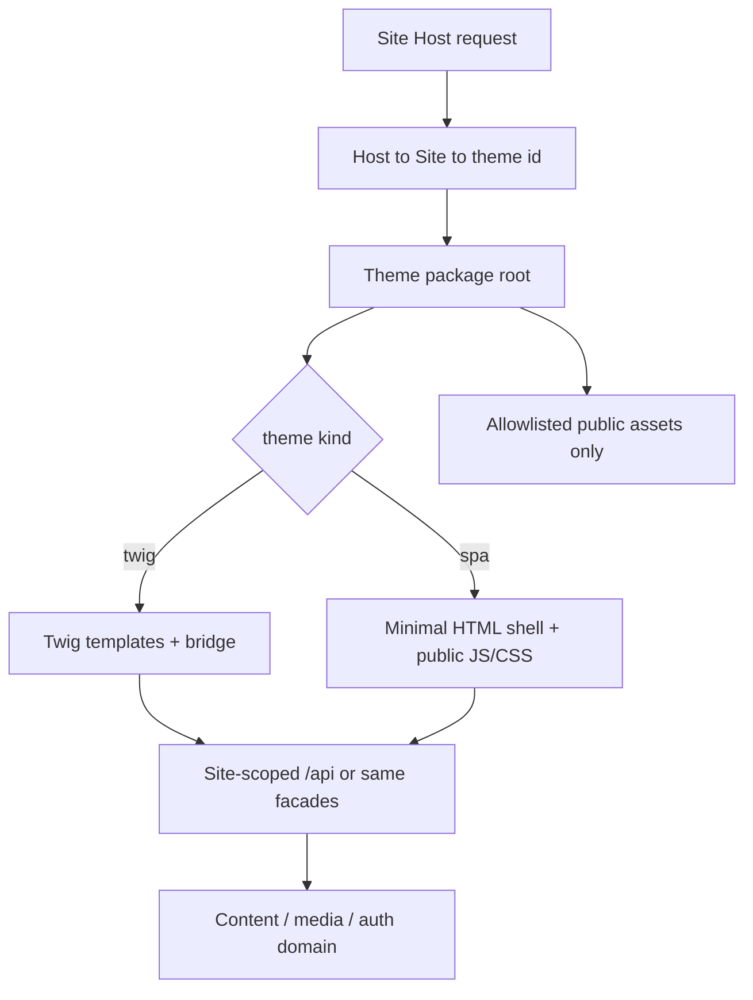

# Public site: API-first themes (SPA + Twig)

> **Status:** accepted direction (2026-10-27) — design locked; implementation not started.  
> **Parent:** [CURRENT.md](./CURRENT.md) · [Frontend_Sites_and_Themes.md](./Frontend_Sites_and_Themes.md) · [Admin98_Integration_Contract.md](./Admin98_Integration_Contract.md) D4 · [Admin_API_Access_Mode.md](./Admin_API_Access_Mode.md).  
> **Language:** English only.

## Intent

Evolve the public (non-admin) stack so **Symfony owns a rich, site-scoped public API**, and **every frontend theme — JS SPA or Twig — obtains content only through that API** (or the same domain services behind it). Themes stay **self-contained packages**; the product manages upload, per-Site assignment, and safe public asset serving.

This ADR **extends** [Frontend_Sites_and_Themes.md](./Frontend_Sites_and_Themes.md). Phase 9 seams (Host → Site → theme id, `theme.json`, shipped/`var/themes`, thin `GET /api/site`) remain. Slice 5’s Twig-direct content render is the **current interim** runtime, not the long-term contract.

## Why

- One content contract for SPA authors and Twig authors.
- Themes never embed Doctrine / admin APIs; they consume a stable public surface.
- Packaging and security (what the browser may load from a theme tree) can be specified once.
- Aligns later `webhemi-js` consumption with the same mental model (API + package), without requiring Node on WebHemi.PHP production.

## Locked decisions

### L1 — Dual consumers, one data plane

| Consumer | Who renders HTML/UI | How data is obtained |
|----------|---------------------|----------------------|
| **SPA theme** | Theme’s own JS (build artefacts in the package) | HTTP calls to site-scoped `/api/…` on the current Host |
| **Twig theme** | Symfony serves Twig from the active theme package | **Not** ad-hoc repository injection in templates. Twig calls **product-provided helpers** that talk to the **same** public API contract (or identical domain facades used by that API) |

Admin UI and admin `/admin/api` stay separate ([Admin_API_Access_Mode.md](./Admin_API_Access_Mode.md)). Frontend session / public auth never shares the admin cookie context.

### L2 — Public API is the product surface for sites

Site hosts expose a **path-based** public API under `/api` (already reserved). Over time this API covers (non-exhaustive; grow by slice):

| Area | Examples |
|------|----------|
| Site identity | Current site, theme id, locale defaults (today: thin `GET /api/site`) |
| Navigation / tree | Menu trees, folder indexes, breadcrumbs |
| Pages | Document payload (Lexical JSON and/or rendered HTML fragments as API fields — choose per endpoint version) |
| Media | Metadata + safe download/stream URLs |
| Auth | Frontend register/login/logout/session “me” |
| Later | Comments, search, forms, … |

Exact resource shapes are **not** frozen here; they land in follow-up API slice docs. The **rule** is frozen: themes do not bypass this plane for CMS data.

### L3 — Twig bridge (shared PHP for themes)

The product ships a **small, documented Twig/PHP bridge** (name TBD: e.g. `WebHemi\Theme\Api` / Twig functions / runtime):

- Callable from theme Twig only for **public** concerns (fetch nav, page by path, media URL, …).
- Implementation **must** use the public API contract or the shared application services that back those endpoints — **no** Twig → EntityManager shortcuts for content.
- Bridge is part of **webhemi-php**, not copied into each theme. Themes depend on the documented function set + `theme.json` `requires` / engine version.

SPA themes do **not** use this bridge; they use HTTP `/api`.

### L4 — Self-contained theme packages (unchanged ownership)

Reaffirm [Admin98_Integration_Contract.md](./Admin98_Integration_Contract.md) D4 and [Frontend_Sites_and_Themes.md](./Frontend_Sites_and_Themes.md):

- One directory per theme id (shipped tree **or** `var/themes/<id>/`).
- Manifest `theme.json` (`id`, `name`, `version`, `engine`, `requires`, …).
- **No** shared UI kit with Admin; no Admin chrome inside site themes.
- Resolver precedence: valid `var/themes/<id>` wins over shipped; upload must not silently overwrite shipped ids (v1: reject).

### L5 — Lifecycle managed in product

| Step | Owner |
|------|--------|
| Author / build theme | Operator or first-party (`webhemi-ui` / external builder later) |
| Upload / install | Admin Control Panel Themes window ([CURRENT](./CURRENT.md) Themes phase) → validate → `var/themes/<id>/` |
| Assign | Per Site `themeId` (CP and/or site settings) |
| Runtime | Host → Site → theme id → package root → SPA entry **or** Twig entry per package type |

Admin Theme is **not** an installable row in Themes CP.

### L6 — Package types (engine kind)

`theme.json` declares how the package is executed (field name TBD; candidates: `render` / `runtime` / extend `engine`):

| Kind | Runtime behaviour |
|------|-------------------|
| `twig` | Symfony selects Twig templates from the package; bridge supplies data |
| `spa` | Symfony serves a shell (minimal HTML) + static entry assets from the package; client hydrates via `/api` |

A package is one kind (not hybrid in v1). Shipped `default` today is Twig-shaped; migration path: keep Twig kind working while the API grows, then optionally add an SPA example theme.

### L7 — Public asset allowlist (security contract)

Browser requests must **not** expose the whole theme tree.

**Allowed (public):** files explicitly published as web assets — typically built CSS/JS, images, fonts, and other files under a designated public subtree (exact layout open — see Open decisions).

**Denied:** sources (TS/SCSS), build configs, Twig sources (except via server-side Twig render, never as static download), `theme.json` optional, dotfiles, anything outside the allowlist.

Serving options to choose in implementation (one or combine):

1. Only files under `assets/public/` (or `dist/`) are routable via a theme asset controller / symlink into AssetMapper.
2. Manifest `expose` / `publicGlob` list in `theme.json`.
3. Deny-by-default static controller with extension + path checks (no `..`, no hidden segments).

Zip validation at upload must reject path traversal and reject or strip disallowed layout patterns where feasible.

## Relationship to current code

| Today | After this ADR |
|-------|----------------|
| `GET /api/site` thin proof | Expand `/api` by slices toward L2 |
| Slice 5: `ContentController` + theme Twig + in-process Lexical HTML | Twig themes call bridge → API/facades; SPA themes fetch JSON; optional HTML fragment fields on API for Twig convenience |
| Themes CP not built | Implement against L4–L7 |
| Lexical media embed / rich editor / media viewers | Separate admin UX work; public media URLs still go through allowlisted media + API |

**Migration rule:** do not break shipped `default` Hello/CMS Twig while introducing the bridge; prefer adapter: existing Twig gradually switches helpers off direct services.

## Out of scope (this ADR)

- Concrete OpenAPI for every `/api` resource (follow-up docs per slice)
- Comment system, search, marketplace billing
- Theme-builder IDE product
- Making site themes look like Retro OS Admin
- `webhemi-js` / Payload packaging details (should **map** to the same package + API ideas later)
- Admin context menu, Lexical upgrades, in-admin media players (tracked elsewhere / CURRENT)

## Open decisions (resolve before or during Themes CP + API expansion)

1. **Twig bridge shape** — Twig functions vs injectable runtime object vs internal HTTP sub-request to `/api`.
2. **Document payload on API** — Lexical JSON only, server-rendered HTML fragment, or both.
3. **Public asset layout** — mandatory `assets/public/**` vs manifest `expose` globs vs both.
4. **SPA shell** — product-owned minimal Twig/HTML vs theme-supplied `index.html`.
5. **Uploaded theme replace** — same id overwrite vs versioned folders.
6. **Site settings vs CP** — where operators pick theme (or both).
7. **When to stop Slice-5-style direct Twig data** — milestone tied to first stable nav+page API.

## Suggested implementation order (when coding resumes)

1. Keep CURRENT admin Phase 1 (context menu wiring) as the short return-to-flow task.
2. Draft public API slice 1 (nav + page-by-path + media URL) + Twig bridge spike on `default`.
3. Themes CP (list / zip / assign) enforcing package layout + asset allowlist validation.
4. Optional shipped SPA example theme once `/api` is useful.
5. Retire direct content injection into Twig as themes migrate to the bridge.

Exact CURRENT renumbering happens when a coding phase is opened; this file is the **design** source of truth until then.

## Related

- [Frontend_Sites_and_Themes.md](./Frontend_Sites_and_Themes.md) — Host → Site → theme seams, zip CP, `var/themes`
- [Site_Content_Slice5.md](./Site_Content_Slice5.md) — interim Twig public routing
- [Site_Content_Model.md](./Site_Content_Model.md) — nodes, publication, media
- [Admin_API_Access_Mode.md](./Admin_API_Access_Mode.md) — `/api` on site hosts, auth split
- [Content_Security_Policy.md](./Content_Security_Policy.md) — later public-site CSP (complements asset allowlist)
- [WebHemi_Architecture_and_Roadmap.md](./WebHemi_Architecture_and_Roadmap.md) — dual-engine vision
